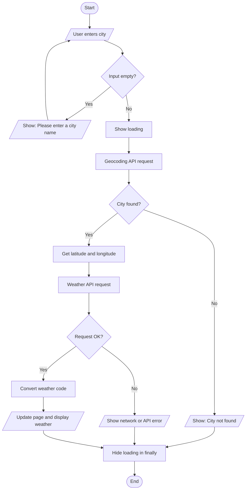

# WEATHER DASHBOARD APPLICATION
### Project Report

*(Replace the [bracketed] items with your own details, and add your screenshots where indicated. Write the AI sections in your own words based on your real use of AI.)*

---

## 1. Title Page
**Project Title:** Weather Dashboard Application
**Submitted by:** [Your Name]  **Roll No.:** [____]
**Department:** Computer Science and Engineering (AI & DS), 3rd Year
**College:** [College Name]  **Subject:** [____]  **Faculty:** [____]
**Date:** [____]

## 2. Introduction
Weather information affects daily plans such as travel, clothing and outdoor events. Most weather websites are crowded with advertisements and extra content. This project is a simple, fast and responsive web application that shows the current weather of any city. It is built only with HTML, CSS and vanilla JavaScript and uses the free Open-Meteo API, so no API key or backend server is needed. The project demonstrates REST API integration, asynchronous programming, JSON handling, DOM manipulation and error handling.

## 3. Problem Statement
Develop a weather dashboard that uses a public weather API to display current weather conditions, allows the user to search by city, validates input, handles API and network errors, and demonstrates asynchronous programming and API integration, using AI as an assistant for integration, debugging and documentation.

## 4. Objectives
- Use a public weather API with the Fetch API.
- Convert city names into coordinates and fetch current weather using those coordinates.
- Apply `async/await`, Promises and `try/catch/finally`.
- Validate input and show clear error messages.
- Update the page dynamically without reloading.
- Create a responsive and accessible interface.
- Document AI-assisted development, testing and Git usage.

## 5. Functional Requirements
1. The user can enter a city name and search using the button or the Enter key.
2. The system trims extra spaces from the input.
3. The system rejects empty input without calling the API.
4. The system finds the city's latitude and longitude (Geocoding API).
5. The system retrieves current weather (Weather API).
6. The system displays temperature, condition, icon, humidity, wind speed and direction, cloud cover, pressure, feels-like temperature.
7. The system displays city, country, region, latitude, longitude and local date/time.
8. The system shows loading, success and error states.
9. The system shows Chennai's weather on first load.

## 6. Non-functional Requirements
- **Usability:** simple interface that beginners can use immediately.
- **Performance:** two small requests; no page reload.
- **Reliability:** no crash on invalid input or network failure; 10-second request timeout.
- **Responsiveness:** works from 320px to 1920px wide.
- **Accessibility:** keyboard operation, labels, ARIA roles, focus styles, good contrast.
- **Maintainability:** commented, small functions; default city in one constant.
- **Portability:** runs in any modern browser, no installation.

## 7. Technologies Used
HTML5, CSS3, JavaScript (ES6+), Fetch API, Open-Meteo Geocoding API, Open-Meteo Weather API, VS Code with Live Server, Git, Google Chrome DevTools.

## 8. System Architecture
Client-side only (no backend):
```
User -> index.html (UI) -> script.js (logic) -> Open-Meteo APIs (internet) -> JSON -> script.js -> DOM update -> User
```
Layers: **Presentation** (HTML + CSS), **Logic** (JavaScript functions), **Data** (external REST APIs).

## 9. API Architecture
| API | URL | Input | Output |
|-----|-----|-------|--------|
| Geocoding | `https://geocoding-api.open-meteo.com/v1/search` | `name`, `count`, `language`, `format` | `results[]` with name, latitude, longitude, country, admin1 |
| Weather | `https://api.open-meteo.com/v1/forecast` | `latitude`, `longitude`, `current`, `timezone` | `current` object, `current_units`, `timezone` |

Both use HTTP `GET` and return JSON. No API key is required.

## 10. Application Workflow
```
User enters city -> Validate input -> Geocoding API request -> Get latitude + longitude
-> Weather API request -> Receive JSON -> Process response -> Convert weather code
-> Update webpage -> Display weather
```
Mermaid version (optional, render at mermaid.live):


## 11. HTML Implementation
Semantic elements (`header`, `nav`, `main`, `section`, `article`, `form`, `footer`); a labelled search form; empty placeholders with IDs (`temperature`, `humidity`, ...) that JavaScript fills; loading and error containers with `hidden`; ARIA attributes (`role="alert"`, `aria-live`). CSS and JS are linked as external files.

## 12. CSS Implementation
CSS variables for colours and spacing; a reset; Flexbox for the header, search form and chips; Grid (`repeat(auto-fit, minmax())`) for the weather cards; gradient backgrounds that change with `data-theme`; shadows, rounded corners, hover transitions; a CSS spinner using `@keyframes`; media queries at 768, 600, 480 and 360px; `prefers-reduced-motion` support.

## 13. JavaScript Implementation
Main functions: `searchWeather()`, `getCoordinates()`, `getWeather()`, `fetchJSON()`, `displayWeather()`, `getWeatherCondition()`, `showLoading()`, `hideLoading()`, `showError()`, `clearError()`, `getWindDirection()`, `formatLocalDateTime()`. Event listeners handle form submission and the quick-city buttons. The default city is the constant `DEFAULT_CITY`.

## 14. API Integration
1. `getCoordinates(city)` builds the URL with `URLSearchParams`, fetches it, checks that `results` exists, and returns name, country, region, latitude and longitude.
2. `getWeather(lat, lon)` requests the `current` variables with `timezone=auto`, and checks that `data.current` exists.
3. `displayWeather()` writes the values into the page using `textContent`.
Weather values are never hard-coded.

## 15. Asynchronous Programming
Network requests take time, so the code uses `async` functions and `await` so the browser stays responsive. `fetch()` returns a Promise; `await` unwraps it. The two requests run in order because the second needs the first one's result. Errors are handled with `try/catch`, and `finally` always resets the loading state. `AbortController` cancels requests that take more than 10 seconds.

## 16. Error Handling
| Case | Message |
|------|---------|
| Empty input | Please enter a city name. |
| Invalid city | City not found. Please check the spelling and try again. |
| Network error | Unable to connect to the weather service. Please check your internet connection. |
| API failure | Weather service is temporarily unavailable. Please try again later. |
| Unexpected error | Something went wrong. Please try again. |
Technical details are logged with `console.error()` only.

## 17. Responsive Design
Fluid typography with `clamp()`, flexible grids, stacked search form and single-column cards below 480px, `overflow-wrap` for long names, and no horizontal scrolling at 1920, 1440, 1024, 768, 600, 480, 375 and 320px (verified).
[Insert screenshots: desktop and 375px mobile]

## 18. Accessibility
Semantic HTML, real labels and buttons, keyboard-only operation, skip link, visible focus outline, ARIA roles and live regions, good colour contrast, and reduced-motion support.

## 19. AI-Assisted Development
AI was used for: (1) understanding and integrating the geocoding and weather APIs, (2) structuring async/await and error handling, (3) improving responsiveness, (4) explaining errors, (5) drafting documentation. All code was reviewed, run and tested by me.
[Paste the five prompts from README.md and summarise each AI answer in 2-3 lines of your own words. Add screenshots of your AI chat.]
**What I learned / what I corrected:** [write your own reflection - e.g. a case where the AI's first answer needed fixing].

## 20. AI Debugging
Example scenarios: (1) weather not displayed - wrong JSON property or element ID; fix by logging the response and comparing; (2) invalid city crash - no `results`; fix by checking before indexing; (3) button stuck disabled - state not reset after an error; fix with `finally`. A real issue found during development: the background gradient stopped partway down the page because of `background-attachment: fixed`; removing it fixed it.

## 21. Git Usage
Commands: `git init`, `git add .`, `git commit -m "..."`, `git log --oneline`.
Commit messages: Initial project setup; Create weather dashboard UI; Add city search functionality; Integrate geocoding API; Integrate weather API; Implement async weather fetching; Add weather condition mapping; Add loading state; Add error handling; Improve responsive design; Add accessibility improvements; Update README documentation.
[Insert screenshot of `git log --oneline`]

## 22. Testing
| Test Case | Input | Expected Result | Actual Result | Status |
|---|---|---|---|---|
| Valid city | Chennai | Weather displayed | [fill in] | [Pass/Fail] |
| Valid city | London | Weather displayed | [fill in] | [Pass/Fail] |
| Empty input | (empty) | Validation message | [fill in] | [Pass/Fail] |
| Invalid city | xyzabc123 | City not found | [fill in] | [Pass/Fail] |
| Spaces | "  Chennai  " | Correct weather | [fill in] | [Pass/Fail] |
| Enter key | Chennai + Enter | Search performed | [fill in] | [Pass/Fail] |
| Network issue | Offline | Error displayed | [fill in] | [Pass/Fail] |
| Mobile | 375px | Responsive layout | [fill in] | [Pass/Fail] |
Fill in the Actual Result and Status columns after testing the running application yourself.

## 23. Results
The application loads the default city on start, retrieves live weather in two API calls, displays all required values, changes its background to match the weather, shows clear loading and error states, and works on all tested screen widths. [Add result screenshots.]

## 24. Advantages
Free, no API key; real-time data; simple code; friendly error handling; responsive and accessible; no installation needed.

## 25. Limitations
Needs internet; depends on Open-Meteo availability and fair-use limits; shows current weather only; only the top geocoding match is used; no user accounts or database.

## 26. Future Enhancements
5-day and hourly forecast, current location detection, favourite cities, search history, Celsius/Fahrenheit switch, dark/light mode, weather charts, air quality, sunrise/sunset, weather alerts.

## 27. Conclusion
The Weather Dashboard meets the assignment requirements. It demonstrates HTML, CSS, JavaScript, REST APIs, JSON, `async/await`, Promises, DOM manipulation, event handling, error handling and responsive design. It also shows how AI can assist with integration, debugging and documentation while the developer remains responsible for understanding, testing and verifying the code.

**References:** Open-Meteo documentation (open-meteo.com/en/docs and open-meteo.com/en/docs/geocoding-api) · MDN Web Docs (Fetch API, Promises, async functions) · Git documentation (git-scm.com)
